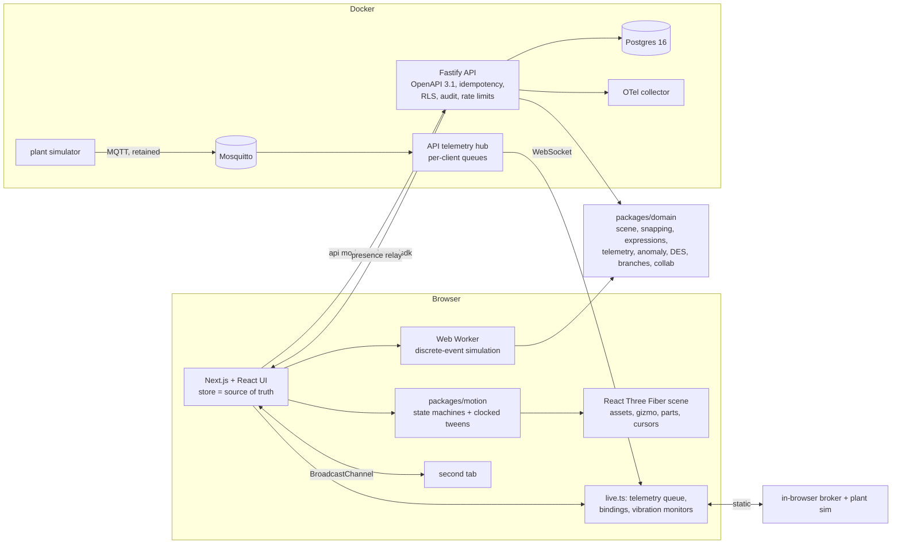

# FORGE: an industrial digital-twin builder in the browser

Build a factory line from an asset library, wire it to plant telemetry, branch it like code, simulate the change and compare
it with production, with two people editing the same scene. The homepage is the product: scrolling assembles a line on an
empty grid, telemetry starts moving it, parts flow through it, and the last chapter turns it into your project.

Built from blueprint 10 of the *Motion-First Interactive Product Engineering Build Book (Volume V)* as a **vertical slice**:
the section 17 demo scenario end to end on the book's stack, with the rest listed under [Not built, and why](#not-built-and-why).

**Everything is synthetic: the plant, its machines, their telemetry (RPM, temperature, vibration, flow, status), the faults and
every simulation result come from generators in this repository. Nothing is a real factory or a real sensor.**

- Live sandbox (static, runs in your browser): https://mrrishit909.github.io/projects/forge-twin-builder/demo/
- 2 min 52 s captioned recording of the whole scenario: [`docs/video/demo.mp4`](docs/video/demo.mp4)
- Case study: https://mrrishit909.github.io/projects/forge-twin-builder/

## Run it

```bash
docker compose up --build -d --wait   # web :8521, API :8520, Postgres :55520, Mosquitto :18830, plant simulator, OTel collector
make test                             # 41 unit + API tests in Docker against a throwaway Postgres and Mosquitto
make e2e                              # 9 Playwright journeys against the static export (needs Google Chrome)
make e2e-docker                       # the section 17 journey against the running Docker stack (API mode)
make seed | make reset | make record | make load-test
```

Open http://localhost:8521. It is the same site as the public sandbox, but built against the API: telemetry comes from the plant
simulator through Mosquitto (password auth) and the API's WebSocket relay; scenes, branches, comments and simulation runs are
stored in Postgres. Local demo tokens: `acme-engineer-demo`, `acme-viewer-demo`, `globex-engineer-demo` (a second tenant, used
by the isolation tests). Invite links carry the project id, so a second tab joins the same project.

## The demo, step by step (section 17)

1. **The factory assembles itself.** An empty grid; scrolling the first chapter drops eight assets into place in flow order
   (raw material, infeed conveyor, CNC mill M1, buffer B1, robot R1, press M2, outfeed conveyor, finished goods), each laid out
   port to port. The second chapter starts preview telemetry: spindles turn at their RPM (drawn at 1/40 speed so 3,200 rpm
   does not alias) and housings warm with temperature. The third runs parts through a recorded simulation of the line.
2. **Create a factory project.** The same scene becomes the editable project (production branch).
3. **Drag a conveyor, a robot and a machine in.** Drop from the library onto the floor. Grid 0.5 m, 15°, 0.1 scale. A connector
   within 1.2 m of a free port pulls the asset onto it, turns it to face the port and links them: the robot dropped 0.6 m off
   the conveyor's end lands port to port. The gizmo moves, rotates and scales with the same snaps; the keyboard nudges.
4. **Connect synthetic MQTT telemetry.** In the sandbox an in-browser broker (retained messages, wildcards, outages) fed by the
   plant simulator at 20 simulated seconds per second; in Docker, Mosquitto with password auth. The API holds the broker
   credentials (AES-256-GCM in the database); the browser asks for the "demo-broker" preset and never sees them.
5. **Bind RPM and temperature to the machine.** `value` drives the spindle, `clamp(value, 20, 120)` the heat glow. Transforms
   go through a small recursive-descent parser (numbers, `value`, + − × ÷, min/max/abs/clamp); `process.exit()` is a parse error, not code.
6. **Branch and add a second machine.** "expansion" starts from production's snapshot. A second CNC machine beside M1 is fed by
   the infeed conveyor and feeds B1 (the inspector's *Fed by* / *Feeds*: a split and a merge, which snapping alone cannot make).
7. **Run the throughput simulation.** A discrete-event model of the branch: 30 shifts of 8 h after a 1 h warm-up, in a Web Worker
   (or on the API), then the first hour played back at 60×.
8. **Compare with production.** Paired replications with common random numbers, so the interval is on the difference:

   | | production | expansion |
   |---|---|---|
   | Throughput, parts/h | 60.8 (59.9–61.6) | 71.8 (70.3–73.2) |
   | Cycle time, min | 7.5 (7.3–7.6) | 4.6 (4.3–5.0) |
   | Work in process | 7.5 | 5.6 |
   | Constraint | CNC mill M1 (busy 98% of the time) | raw-material supply, 72/h (busiest station press M2, 79%) |

   **+11.0 parts/h (95% interval 9.4 to 12.6) for $240,000 of added capex.** The second machine does not make the press the new
   bottleneck: the line becomes limited by how fast raw material is released (it now waits for room 9% of the time, against
   98% before). The generator's scripted run (`data/fixtures/evaluation.json`) gives +10.9 (9.3–12.5): the machine there has
   a different id, so it draws different random numbers. Buffer B1's size barely matters (60.3–61.0 parts/h for 0 to 8 slots;
   the optimizer picks 1), because it sits after the bottleneck.
9. **Invite a collaborator, leave a world-space comment.** A second tab joins from the invite link; its cursor shows on the
   factory floor, and a comment it pins at a floor position appears in the first tab (BroadcastChannel in the sandbox, the API's
   WebSocket relay in Docker, where comments are stored).

Also in the sandbox: a bearing fault on press M2 (Failure lab) raises a vibration alarm while the press is still running; the
broker dropping for 6 s (values go stale, the connector backs off, retained messages refill it); a 20,000-message telemetry
storm (the queue coalesces and drops instead of freezing the page); a lost GPU context (list view, then back); a
2,000-asset factory campus. The URL keeps branch, selection, view and camera bookmark; the sandbox keeps your draft in this
browser so a deep link reopens it.

## Architecture



| Piece | What it does |
|---|---|
| `packages/domain` | **Scene**: asset library with connector ports, grid/angle/scale snapping, connector-aware snapping (turn to face, move so ports coincide, link), canonical JSON serialization with validation. **Expressions**: the binding-transform parser. **Telemetry**: seeded machine simulator (load cycles, first-order thermal lag, bearing fault growing until a trip), MQTT topic matching, an in-memory broker with retained messages and outages, a bounded per-consumer queue (coalesce per topic, drop oldest), jittered exponential backoff. **Anomaly**: vibration robust z-score (median/MAD baseline learned while healthy) smoothed with an EWMA. **DES**: stations from the scene graph (only what raw material can reach), blocking after service, FIFO conveyors, machine failures on an MTBF/MTTR clock, warm-up, replications, Student-t intervals, paired comparison, buffer sizing. **Branches**: diff and three-way merge with conflicts. **Collab**: last-writer-wins registers per (asset, field) ordered by (Lamport clock, actor), idempotent and order-independent. |
| `packages/motion` | Deterministic state machines and an orchestrator that tweens on an explicit clock. Reduced motion makes every duration 0; pause holds tweens. |
| `packages/telemetry` | Web Vitals, FPS and p95 frame time, long tasks, GPU context loss, scene-load and shader-compile time, renderer counters, W3C traceparent. |
| `apps/web` | Next.js 16 static export. Intro chapters over the persistent canvas; editor panels (library, inspector with live sparklines and bindings, flow links, branches, simulation, comparison, people and comments); command palette; keyboard editing; list view; failure lab; telemetry HUD. Instanced 2,000-asset campus with a near/far level of detail. |
| `apps/api` | One Fastify process for the section 6 contract plus a telemetry hub (one MQTT subscription, fanned out over WebSockets with per-client queues, latest values stored once a second), a collaboration relay, three-way merge, server-side simulation and the failure lab. Bearer tokens with roles (viewer / engineer), row-level security per tenant, idempotency keys, hash-chained audit log, rate limits, `/metrics`, OpenTelemetry spans. |
| Postgres | Section 5 tables (`twin_projects`, `assets`, `connectors` with `config_encrypted BYTEA`, `telemetry_bindings`, `telemetry_points`, `scenario_branches`, `simulation_runs`) with tenant_id and RLS; additions: `scene_ops` (every stamped edit), `comments`, base snapshots for merges. |

## What the tests check

| Test | Result |
|---|---|
| Snapping | grid/angle/scale; connector snap from either side lands ports within 1e-6 m and links them; far or taken ports do not snap |
| Serialization round trip | 200 random scenes: `parse(serialize(s)) = s`, bytes independent of key order; broken scenes refused (version, duplicate ids, unknown types, non-positive scale, dangling links, NaN props, bindings to missing assets) |
| Binding expressions | arithmetic and functions evaluate; `process.exit()`, `constructor`, `value[0]`, template strings and 200-character inputs are refused |
| Connector contract | the in-browser broker and the MQTT connector against real Mosquitto (cut and restored through a TCP proxy) both: connect, filter, notice the drop, back off, reconnect, refill from retained messages |
| Backpressure | 10,000 messages into a 256-slot queue: never over capacity, latest value per topic kept, every message either delivered, coalesced or dropped |
| Simulation | same seed, identical result and event trace; parts conserved (released = finished + in process); Little's law within 5%; a deterministic one-machine line gives its analytic 60 parts/h (within 0.2); bottleneck and supply limit identified; expansion gain's interval excludes zero |
| Predictive maintenance | 50 faulty runs: 50 alarms, none before the fault, median 22.3 min before the trip (10th–90th percentile 21.3–23.4); 50 healthy 8-hour runs: no alarms. The fault and the detector come from the same generator, so this checks the code, not real-world accuracy. |
| Branches and multiplayer | merge applies one-sided changes and reports both-sided ones and edits to removed assets; 50 random sessions of 30 ops delivered in shuffled orders with duplicates converge to the same scene |
| API (14 tests, bodies validated against the published OpenAPI 3.1) | idempotent replay and 409 on reuse; viewer 403, no token 401; another tenant gets 404 on the project, its assets, branches and telemetry socket; RLS blocks a WHERE-less query, survives an emptied `app.tenant`, refuses a cross-tenant insert; connector secret absent from every response, not in plain text in the database, not in the web bundle; telemetry relay batches and coalesces, reports broker status through a lab outage; time series stored; branch, simulate, compare, buffer sizing, merge with a conflict; presence relay and comment persistence (viewer edits not relayed); audit chain valid; trace id propagated; 429 with headers |
| Playwright (9 journeys, plus the section 17 walk again against Docker) | section 17 end to end with a second tab and a deep-link reload; reduced motion; keyboard-only editing; broker outage and recovery; telemetry storm; bearing fault alarm; GPU context loss and recovery; 2,000-asset campus (3 draw calls); visual baselines of the assembled line, the flow chapter and the editor |
| Coverage (domain + motion) | 98% of statements, 100% of lines (threshold 85%) |

## Performance and observability

- **Browser, real GPU** (headless Chrome with Metal, during the recording): 60 FPS, p95 frame 18.0 ms, 42 draw calls for the
  line, shader compile 9 ms, LCP 100 ms on localhost.
- **2,000-asset campus, software rendering** (SwiftShader in the e2e test): 3 draw calls (instanced), 14 FPS, a floor rather
  than a GPU figure (`docs/performance-e2e.json`). The near/far level of detail is recomputed 10 times a second.
- **Simulation**: one 9-hour run of the line in about 10 ms; 30 replications in about 120 ms (worker or API).
- **API** (same machine, shared with other builds, `docs/load-test.json`): reads 1,931 req/s, p95 27.7 ms, 0 errors; the 30-shift
  simulation endpoint about 5 req/s at p95 2.0 s (CPU-bound); 2,000 WebSocket telemetry clients held open, each receiving about
  12 coalesced readings a second.
- About 2 MB of JavaScript in the static export (uncompressed).
- Traces: the browser sends `traceparent`; the API logs the trace id on every line, returns it in errors, and exports HTTP and
  Postgres spans to the collector.

## Tradeoffs

- **One API process for twelve services.** The blueprint's project, asset-library, scene, telemetry-gateway, connector,
  twin-runtime, simulation, optimization, collaboration, version-control, reporting and billing services share one domain
  package and split along route groups. Most would wrap one table, which the book warns against.
- **Op log, not CRDT library.** Asset fields are last-writer-wins registers; links, bindings and comments are add-only sets.
  Concurrent moves of the same asset resolve to one of them, not a blend, which is the behaviour engineers expect from a CAD
  tool. Text merging and undo across users are not needed by this slice.
- **Same code in the browser and the server.** The simulator, snapping, parser and merge run in both, so the public sandbox
  needs no backend and the API's answers match the page's.
- **Discrete-event, not physics.** Throughput, blocking and failures are what the blueprint's question needs; rigid-body physics
  for collisions is listed as optional and is not built.
- **Telemetry by coalescing.** A slow client gets the latest value per topic rather than every sample; the anomaly detector runs
  before the queue so it still sees every sample.

## Not built, and why

- Real connectors to plant equipment, OPC-UA and Modbus gateways (there is no plant; MQTT and an in-browser simulator stand in).
- Kafka, TimescaleDB, Redis presence, object storage for scenes/models/results: one broker, Postgres and in-memory rooms are
  enough for this slice; telemetry is stored at 1 Hz.
- Rigid-body physics, energy and machine-assignment optimization (buffer sizing is the one optimizer built), predictive models
  beyond the vibration detector, glTF/KTX2 asset library (procedural meshes stand in), WebGPU.
- Terraform, Kubernetes, edge agents that buffer telemetry offline, signed images, SBOM, canary releases: no cloud account here;
  the public deployment is the static export on GitHub Pages; `.github/workflows/ci.yml` runs audit, type-check, tests and e2e.
- Single sign-on, MFA, billing and plans; undo/redo; persisted presence; operator constraints, changeovers and scrap in the
  simulation.
- A production-like load test across machines; chaos testing of the database.

## Layout

```
apps/web          Next.js site (intro + editor), scene, simulation worker, UI
apps/api          Fastify API, telemetry hub, MQTT connector, migrations, seed
packages/domain   scene, snapping, expressions, telemetry, anomaly, DES, branches, collab + tests
packages/motion   state machines, tweens + tests      packages/telemetry  frontend telemetry
packages/sdk      typed API client                     data/simulators     template generator, plant simulator
tests/e2e         Playwright                           tests/performance   load test
infra             Dockerfiles, nginx (CSP), Mosquitto, OTel collector       docs  OpenAPI, load and perf results, video
```
